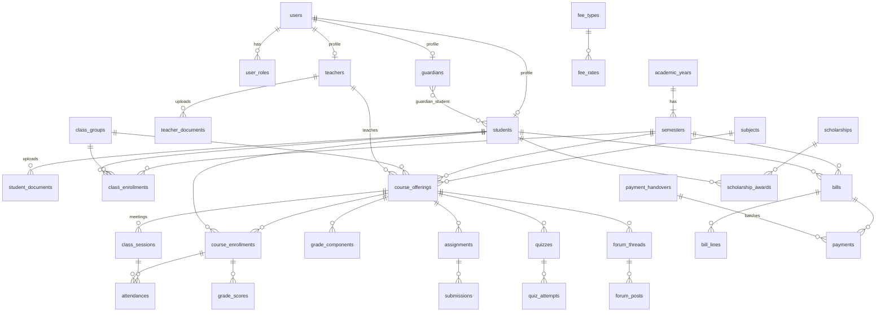
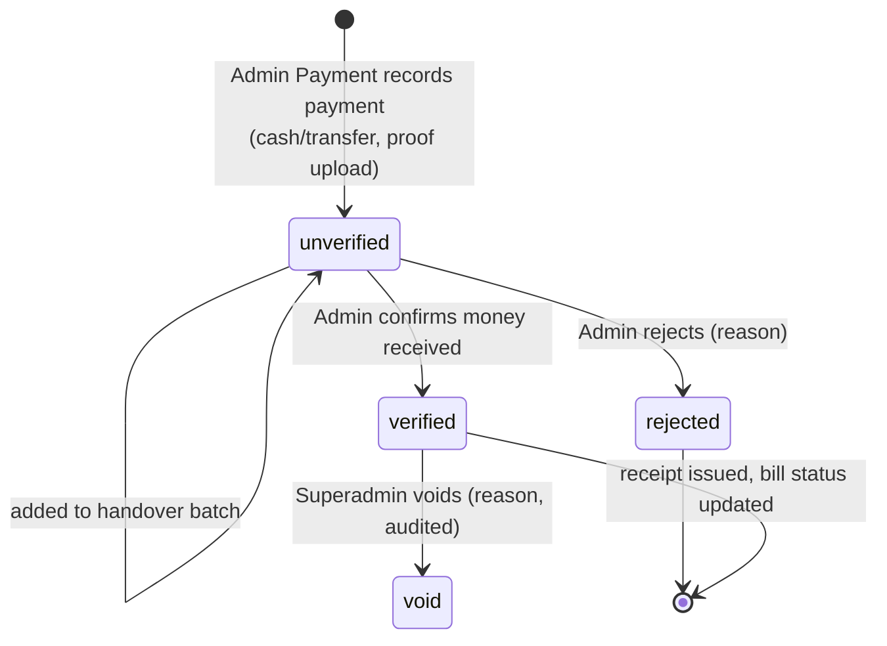

# SIAKAD Mahad Aly — System Design

Source requirements: [`project.md`](../project.md). This document analyses those requirements against the
current codebase and turns them into a buildable design: architecture, data model, auth, module
behaviour, and a delivery plan.

---

## 1. Analysis

### 1.1 Starting point (what the repo already is)

| Area | Current state | Gap vs. spec |
| --- | --- | --- |
| Framework | Laravel 13, PHP 8.3 | ✅ |
| UI | Livewire 4 (single-file `⚡` components), Flux 2, Tailwind 4, Blaze | ✅ Alpine ships with Livewire |
| Auth | Fortify, login by **email**, passkeys, 2FA, email verification | ❌ must log in by **NIM / NIDM / username / guardian code** |
| Registration | Public self-registration enabled | ❌ accounts must be created by admins only |
| Roles | None | ❌ 7 roles needed |
| Database | SQLite | ❌ PostgreSQL required |
| Domain | Only `User` | ❌ everything else |
| Tests | Pest 5, Larastan, Pint | ✅ |

### 1.2 Key findings & decisions

1. **Login identifier.** All roles authenticate with one identifier and a password. Store it in a single
   unique `users.username` column (NIM for students, NIDM for teachers, generated code for guardians,
   free-form for staff). Fortify's `username` config switches to `username`; email becomes **nullable**.
2. **Email-dependent features must go or change.** Self-registration, email verification and the
   `verified` middleware are removed. Students/guardians may have no email, so **password reset is
   admin-driven** (admin sets a temporary password, `must_change_password` flag forces a change at next
   login). Email reset stays available only for users who have an email.
3. **Users can hold several roles** (an ustadz may also be the academic monitor). Use a `user_roles`
   table with a PHP `Role` enum rather than a single column; the user picks an active role when they have
   more than one.
4. **"Zero Overwriting" is the core architectural rule.** It is met by:
   - every academic and financial fact being keyed to a **semester** (and through it, the academic year);
   - **closing** a semester makes all its records read-only (enforced in policies, not just UI);
   - **snapshotting** values that can change later (subject name, SKS, fee amounts, class name) onto the
     historical row;
   - no hard deletes on master data (soft deletes) and **no deletes at all** on grades/payments
     (void/correct with reason + audit log).
5. **Payment roadmap needs separation of duties.** Spec: *pay → Admin Payment records (unverified) →
   money handed to Admin → Admin verifies.* The recorder and verifier must be different roles, and only
   **verified** payments count toward a bill being paid. Cash handover is modelled as a batch
   (`payment_handovers`) so the Admin verifies one deposit, not 200 rows one by one.
6. **"Course offering" is the hub.** A subject taught by a teacher to a class in a semester
   (`course_offerings`) is what attendance, grades, assignments, quizzes, meeting links and forums all
   hang off. This keeps LMS data automatically historical.

### 1.3 Open questions

| # | Question | Status | Answer / assumption |
| --- | --- | --- | --- |
| Q1 | Is there more than one programme of study (prodi)? | Assumed | One programme; `study_programs` table exists so a second can be added. |
| Q2 | Credit system (SKS) and IP/IPK on KHS/transcript? | Assumed | Yes — SKS per subject, 4.00 scale, configurable grade scale. |
| Q3 | Who verifies payments — Admin or Superadmin? | Assumed | Role **Admin** (Superadmin can too). |
| Q4 | Can a student pay partially / in instalments? | **Decided** | Yes — a bill is `unpaid` / `partial` / `paid`, with a **maximum number of instalments** per bill and a **minimum instalment of Rp 200.000** (see §5C). |
| Q5 | Does a guardian log in with code **and** password? | Assumed | Yes — generated code + generated initial password, printed on a credential slip. |
| Q6 | What are "daily activities" for the Academic Monitor? | **Decided** | Pesantren activity log (e.g. halaqah, tahfidz setoran) for monitoring only. The **academic record contains class attendance only** — activity logs never feed KHS/transcript. Generic `activity_logs` module, phase 4. |
| Q7 | Do online payment gateways matter now? | Assumed | No — cash/transfer recorded manually. Gateway is a later extension. |
| Q8 | Is a class (kelas) the same as a dormitory? | **Decided** | Dormitories are **not recorded**. `class_groups` are academic classes only; a student is in exactly one class per semester. |
| Q9 | What is the maximum number of instalments per bill? | **Decided** | **3**, stored as a setting (`payment.max_installments`) so it can be changed later. |
| Q10 | Does a missing required document block anything for students? | **Decided** | No blocking — persistent reminder + admin completeness report (see §5B). |

---

## 2. Architecture

```
Browser ── Livewire 4 / Flux / Alpine
   │
Laravel 13
   ├── Fortify (identifier login, 2FA, passkeys optional)
   ├── Role middleware + Policies (authorization, semester lock)
   ├── Livewire page components   resources/views/pages/{area}/⚡*.blade.php
   ├── Actions (business logic)   app/Actions/{Domain}/*.php
   ├── Models + Enums             app/Models, app/Enums
   ├── Queued jobs                imports, exports, bulk billing, PDFs
   └── Storage (private disk)     submissions, materials, receipts
   │
PostgreSQL ─ Redis (optional: cache/queue/session in production)
```

**Conventions**

- Livewire components stay thin: validate, authorize, call an **Action** class
  (`App\Actions\Finance\RecordPayment`), show the result. Actions are unit-testable and reused by
  imports/console commands.
- One **policy per model**; a shared `EnsureSemesterIsOpen` check is used by every policy guarding
  semester-scoped writes.
- Enums for all statuses (`app/Enums`), stored as strings.
- Money stored as **integer rupiah** (`bigInteger`), never float.
- All tables that hold history get `created_by` / `updated_by` and are covered by an `audit_logs` table
  (who, what, old → new, when).

**Packages to add** (verify Laravel 13 support before installing)

| Need | Package |
| --- | --- |
| Excel/CSV import & export — master data **and** teacher score entry | `spatie/simple-excel` (streaming, light) |
| PDF receipts, KHS, transcript | `spatie/laravel-pdf` or `barryvdh/laravel-dompdf` |
| Audit log | own `audit_logs` table + model observer (small, no dependency) |

---

## 3. Authentication & Authorization

### 3.1 Roles

```php
enum Role: string
{
    case Superadmin      = 'superadmin';
    case Admin           = 'admin';
    case AdminPayment    = 'admin_payment';
    case AcademicMonitor = 'academic_monitor';
    case Teacher         = 'teacher';    // Ustadz / Dosen — login NIDM
    case Student         = 'student';    // Mahasantri    — login NIM
    case Guardian        = 'guardian';   // Wali Santri   — login generated code
}
```

### 3.2 Login flow

1. Login form asks for **ID Number** + password (no email).
2. `Fortify::authenticateUsing()` finds the user by `username`, checks `is_active`, checks the password.
3. If `must_change_password` → redirect to a change-password page before anything else.
4. If the user has several roles → role picker, stored in session (`active_role`); one role → set
   automatically.
5. `/dashboard` redirects to the active role's home.

Login is rate-limited (Fortify default throttle). 2FA stays optional and is **recommended to be forced**
for Superadmin, Admin and Admin Payment.

### 3.3 Route areas

| Prefix | Role(s) | Home |
| --- | --- | --- |
| `/superadmin` | Superadmin | system settings, users & roles, audit log |
| `/admin` | Admin, Superadmin | master data, users, classes, enrolment, payment verification |
| `/finance` | Admin Payment | bills, payments, scholarships, receipts |
| `/monitor` | Academic Monitor | attendance & progress dashboards, activity log |
| `/ustadz` | Teacher | my course offerings → LMS, attendance, grading |
| `/mahasantri` | Student | schedule, LMS, KHS/transcript, bills |
| `/wali` | Guardian | children's progress, attendance, payment history (read-only) |

Each group uses `->middleware(['auth', 'role:admin,superadmin'])`; record-level access (e.g. a teacher
only sees their own offerings, a guardian only their own children) is enforced in **policies**.

### 3.4 Permission matrix (summary)

| Capability | SA | Adm | Pay | Mon | Ust | Mhs | Wali |
| --- | :-: | :-: | :-: | :-: | :-: | :-: | :-: |
| System config, roles | ✅ | | | | | | |
| Master data, users, enrolment | ✅ | ✅ | | | | | |
| Open / close semester | ✅ | ✅ | | | | | |
| Fee structure, bills, scholarships | ✅ | | ✅ | | | | |
| Record payment | ✅ | | ✅ | | | | |
| Verify / reject payment | ✅ | ✅ | | | | | |
| View attendance & grades (all) | ✅ | ✅ | | ✅ | | | |
| Manage own offerings (LMS, grades, attendance) | | | | | ✅ | | |
| Submit assignments, take quizzes, forum | | | | | ✅ | ✅ | |
| Own KHS / transcript / bills | | | | | | ✅ | |
| Children's data (read-only) | | | | | | | ✅ |

---

## 4. Data Model

### 4.1 ER overview



### 4.2 Tables

**Identity**

| Table | Key columns |
| --- | --- |
| `users` | `username` (unique: NIM/NIDM/code), `name`, `email` (nullable, unique), `password`, `is_active`, `must_change_password`, `last_login_at`, 2FA columns |
| `user_roles` | `user_id`, `role` (enum string), unique(user_id, role) |
| `students` | `user_id`, `nim` (unique), `photo_path`, `entry_year`, `study_program_id`, `gender`, `birth_place`, `birth_date`, `address`, `phone`, `father_name`, `father_is_alive`, `mother_name`, `mother_is_alive`, `guardian_name` (nullable — wali when not the parents), `status` (`active`, `leave`, `graduated`, `dropped_out`), `graduated_at` |
| `teachers` | `user_id`, `nidm` (unique), `nik` (unique, nullable), `photo_path`, `title` (gelar), `gender`, `birth_place`, `birth_date`, `address`, `phone`, `expertise` (keahlian), `scopus_id` (nullable), `google_scholar_url` (nullable), `status` |
| `guardians` | `user_id`, `code` (unique, generated), `relationship`, `phone` — the name lives on `users.name` |
| `guardian_student` | `guardian_id`, `student_id` |
| `student_documents` | `student_id`, `type` (`ktp`, `kk`, `ijazah`), `file_path` (nullable), `status` (`missing`, `uploaded`, `verified`, `rejected`), `uploaded_at`, `verified_by`, `verified_at`, `rejection_note` — unique(student_id, type) |
| `teacher_documents` | `teacher_id`, `type` (`ktp`, `kk`, `ijazah`), `file_path` (nullable), `status` (`missing`, `uploaded`, `verified`, `rejected`), `uploaded_at`, `verified_by`, `verified_at`, `rejection_note` — unique(teacher_id, type) |

Notes on identity data:
- A teacher's email is the existing `users.email` (not duplicated on `teachers`).
- `guardian_name` is the informational wali name from the student's biodata; the guardian **login
  account** is the separate `guardians` record linked via `guardian_student`.
- `father_is_alive` / `mother_is_alive` are booleans (useful for yatim/piatu scholarship eligibility).
- Document types are a PHP enum, so new types (akta kelahiran, pas foto…) are a one-line addition.
- Photos and documents are personal data: stored on the **private** disk and served only through an
  authorised route (owner, Admin, Superadmin).

**Academic structure** (master data — soft deletes)

| Table | Key columns |
| --- | --- |
| `study_programs` | `name`, `code` |
| `academic_years` | `name` ("2026/2027"), `starts_on`, `ends_on` |
| `semesters` | `academic_year_id`, `term` (`odd`/`even`), `status` (`planned`, `active`, `closed`), `starts_on`, `ends_on`. **Exactly one `active`** (partial unique index in Postgres). |
| `class_groups` | `name`, `level` (marhalah/tingkat), `study_program_id` — academic classes only (no dormitories, Q8) |
| `subjects` | `code`, `name`, `kitab` (reference text), `credits` (SKS), `study_program_id`, `is_active` |
| `grade_scales` | `letter`, `min_score`, `point` (4.00) — one current scale, editable by Admin. No versioning needed: finalised grades keep the letter and point they got. |

**Semester-scoped history** (never hard-deleted, locked when semester closes)

| Table | Key columns | Snapshot columns |
| --- | --- | --- |
| `class_enrollments` | `student_id`, `class_group_id`, `semester_id` — unique(student, semester) | `class_name` |
| `course_offerings` | `subject_id`, `semester_id`, `class_group_id`, `teacher_id`, `schedule` (day, time, room) | `subject_code`, `subject_name`, `credits` |
| `course_enrollments` | `course_offering_id`, `student_id`, `final_score`, `final_letter`, `final_point`, `finalized_at` | — |
| `grade_components` | `course_offering_id`, `name` (Tugas, UTS, UAS, Hafalan…), `weight` (sum = 100) | — |
| `grade_scores` | `course_enrollment_id`, `grade_component_id`, `score` | — |
| `class_sessions` | `course_offering_id`, `meeting_no`, `held_on`, `topic`, `mode` (`offline`/`online`), `meeting_url`, `meeting_provider` | — |
| `attendances` | `class_session_id`, `course_enrollment_id`, `status` (`hadir`, `izin`, `sakit`, `alpa`), `note` | — |

`semester_id` is derived through `course_offering_id` for LMS/grade tables, so one foreign key carries
the history; `course_offerings.semester_id` is indexed for semester-wide reports.

**LMS**

| Table | Key columns |
| --- | --- |
| `materials` | `course_offering_id`, `title`, `body`, `file_path`, `url` |
| `assignments` | `course_offering_id`, `title`, `instructions`, `due_at`, `allow_late`, `max_score`, `grade_component_id` (nullable — feeds grades) |
| `submissions` | `assignment_id`, `student_id`, `file_path`, `text`, `submitted_at`, `is_late`, `score`, `feedback`, `graded_at` — unique(assignment, student), resubmission overwrites until graded |
| `quizzes` | `course_offering_id`, `title`, `opens_at`, `closes_at`, `duration_minutes`, `max_attempts`, `shuffle`, `grade_component_id` |
| `quiz_questions` | `quiz_id`, `type` (`single_choice`, `multiple_choice`, `true_false`, `essay`), `body`, `points`, `order` |
| `quiz_options` | `quiz_question_id`, `body`, `is_correct` |
| `quiz_attempts` | `quiz_id`, `student_id`, `started_at`, `submitted_at`, `score`, `needs_manual_grading` |
| `quiz_answers` | `quiz_attempt_id`, `quiz_question_id`, `selected_option_ids` (json), `text`, `points_awarded` |
| `forum_threads` | `course_offering_id`, `user_id`, `title`, `body`, `is_pinned`, `is_locked` |
| `forum_posts` | `forum_thread_id`, `user_id`, `body` (soft delete for moderation) |

**Finance**

| Table | Key columns |
| --- | --- |
| `fee_types` | `name` (SPP, Daftar Ulang, Asrama, Wisuda…), `frequency` (`per_semester`, `once`, `monthly`) |
| `fee_rates` | `fee_type_id`, `academic_year_id`, `class_group_id` (nullable), `entry_year` (nullable), `amount` — most specific match wins (class + entry year > class > entry year > all). Per academic year, not per semester. |
| `bills` | `student_id`, `semester_id`, `number` (unique), `due_on`, `gross_amount`, `discount_amount`, `net_amount`, `max_installments` (snapshot of the setting at generation), `status` (`unpaid`, `partial`, `paid`, `void`) |
| `bill_lines` | `bill_id`, `fee_type_id`, `description`, `amount` (snapshot), `scholarship_award_id` (nullable, negative line) |
| `scholarships` | `name`, `funding_source` (yayasan, pemerintah, donatur…), `type` (`percent`, `fixed`, `full`), `value`, `quota`, `academic_year_id` |
| `scholarship_awards` | `scholarship_id`, `student_id`, `semester_id`, `approved_by`, `note` — the applied amount lives on its `bill_lines` row |
| `payments` | `bill_id`, `amount`, `method` (`cash`, `transfer`), `paid_on`, `reference`, `proof_path`, `status` (`unverified`, `verified`, `rejected`, `void`), `recorded_by`, `verified_by`, `verified_at`, `status_note` (rejection / void reason), `payment_handover_id`, `receipt_number` (unique, `KW/2026/000001`, issued on verification) |
| `payment_handovers` | `number`, `handed_over_by` (Admin Payment), `received_by` (Admin), `total_amount`, `status` (`submitted`, `verified`, `partially_rejected`), `submitted_at`, `verified_at` |
| ~~`receipts`~~ | Not built (Phase 2 decision): the receipt number is on `payments`; the PDF is rendered on demand from the payment, never stored. |

**Platform**

| Table | Purpose |
| --- | --- |
| `audit_logs` | `user_id`, `auditable_type/id`, `event`, `old_values`, `new_values`, `ip`, `created_at` |
| ~~`imports`~~ | Not built (Phase 1 decision): imports run inside the page — check, then import — with row errors shown on screen; created accounts are covered by the audit log. Add a table if imports move to a queue. |
| `settings` | key/value: institution name, logo, receipt footer, grade rules, `payment.max_installments` (default 3), `payment.min_installment_amount` (default 200000) |

### 4.3 How "Zero Overwriting" is enforced

| Threat | Protection |
| --- | --- |
| New semester changes a student's class | New `class_enrollments` row per semester; old row untouched |
| Subject renamed / SKS changed | Name, code and credits snapshotted on `course_offerings` |
| Fee amount changes next year | Rates are per academic year; bills snapshot amounts in `bill_lines` |
| Someone edits last year's grades | `semesters.status = closed` → policies deny writes; only Superadmin can **reopen** (logged) |
| Master record deleted | Soft deletes on master data; FKs `restrictOnDelete` for history tables |
| Payment mistake | No delete — `void` with reason; correction is a new payment |
| Silent changes | `audit_logs` on grades, payments, enrolments, semester status |

---

## 5. Module Design

### A. Master data & semester lifecycle

```
planned ──open──▶ active ──close──▶ closed
                    ▲                  │
                    └──reopen (SA)─────┘
```

**Open next semester wizard** (Admin):
1. Create/choose academic year and semester.
2. Copy class enrolments from the previous semester (with promotions: level +1 on odd semester),
   excluding graduated/dropped-out students — review screen before committing.
3. Copy course offerings template (subject × class × teacher) — editable.
4. Generate bills for the semester (queued job, see C).
5. Activate (previous semester must be closed or is closed in the same step after grades are finalised).

Closing checks: all `course_enrollments` finalised, warns about unverified payments.

### B. User management

- CRUD per type; creating a student/teacher creates `users` + profile + role in one Action.
- **Bulk import** (CSV/XLSX, queued): template download → upload → validate every row → preview with
  errors → commit valid rows; error report downloadable. Initial passwords generated and exported once as
  a credential sheet (PDF/XLSX) — never stored in plain text.
- Guardian codes: `WS-` + 8 random uppercase chars (no ambiguous characters), unique.
- Export of students/teachers with filters (class, semester, status).
- Admin password reset → temporary password + `must_change_password`.
- Deactivate instead of delete (`is_active = false`).

**Personal documents (KTP, KK, Ijazah)**

```
missing ──upload──▶ uploaded ──verify──▶ verified
                       │  ▲
                 reject│  │re-upload
                       ▼  │
                     rejected
```

- When a student or teacher is created (manually or by import), one `missing` row per required document
  type is created. Admins may upload on their behalf; otherwise the owner uploads later.
- **Students must upload**: a persistent reminder on the student dashboard lists missing/rejected
  documents until all are `verified` (no feature blocking — Q10).
- **Teachers are requested to upload**: the same reminder on the ustadz dashboard, softer wording.
- Admin has a **document completeness** page: filter by owner (mahasantri/ustadz), status, type and
  ID/name search; view, verify or reject with a note (the owner sees the note and can re-upload).
  Re-uploading points the record at the new file and resets the status to `uploaded`; previous files
  stay on disk for audit.
- Allowed files: PDF/JPG/PNG, max 2 MB each.

### C. Finance & scholarships

**Billing**
1. Admin Payment defines `fee_rates` for an academic year.
2. "Generate bills" for a semester: for each active student, resolve applicable rates → `bill_lines`,
   apply active `scholarship_awards` as negative lines → `bills.net_amount`. Idempotent (skips students
   who already have a bill for that semester).
3. Bill status is recalculated from **verified** payments only.

**Instalment rules** (Q4) — enforced in the `RecordPayment` action, not only the form:
- A bill accepts at most `bills.max_installments` payments (default 3; counts every payment that is not
  `rejected` or `void`).
- Each payment must be **≥ Rp 200.000** (`payment.min_installment_amount`), **except** a payment that
  settles the whole remaining balance, which may be smaller.
- A payment may not exceed the remaining balance (net amount − verified − unverified payments), so
  pending payments cannot cause an overpayment.
- The last allowed instalment must settle the remaining balance in full.
- Superadmin can override the instalment limit for a single bill (reason required, audited).

**Payment roadmap**



- Admin Payment cannot verify their own entries; Admin cannot record payments (separation of duties).
- **Handover (setoran)**: Admin Payment selects unverified cash payments → creates a handover batch with
  total → Admin counts the money, verifies the batch (or rejects individual payments).
- Transfers can be verified individually against the bank statement.
- **Receipts**: an *official* receipt PDF is generated only after verification; a provisional
  "payment recorded" slip may be printed at the counter, clearly marked *Belum Terverifikasi*.
- Dashboard: billed vs. collected vs. pending verification per semester / class; arrears list.
- Guardians/students see bills, verified payments and receipts; unverified payments shown as "pending".

**Scholarships**: define scholarship with funding source and quota → award to students per semester
(quota enforced) → applied at bill generation; awarding after a bill exists adds a discount line to that
bill (audited). Report per funding source.

### D. LMS (per course offering)

The teacher's workspace is one page per offering with tabs: **Overview · Meetings · Materials ·
Assignments · Quizzes · Forum · Attendance · Grades**. Students see the same tabs minus management.

- **Meetings**: each `class_session` can be online with a Zoom / Google Meet / Jitsi URL; "Join" button
  shown 15 min before start. Attendance is taken per meeting (teacher marks; bulk "all present" default).
- **Assignments**: deadline with countdown, file upload to private disk (type/size limits),
  late flag, grading with feedback, optional link to a grade component.
- **Quizzes**: question bank per quiz, timed attempts (server-side `started_at` + duration — the
  client timer is only cosmetic), auto-grading for choice questions, manual for essays.
- **Forum**: threads + replies per offering; teacher can pin/lock/delete; refresh via
  `wire:poll.visible` (Laravel Reverb is a later upgrade for live chat).
- **Grades**: teacher sets components and weights → scores entered in a spreadsheet-like grid →
  computed final score → letter/point from `grade_scales` → **Finalise** locks the column.
- **Score import from Excel**: the teacher downloads a template pre-filled with the offering's enrolled
  students (NIM, name) and one column per grade component → fills scores offline → uploads → preview
  shows each row as *new / changed / unchanged / error* → apply. Rows are rejected when the NIM is not
  enrolled in that offering, a score is outside 0–100, or a column does not match a component. Import
  is refused once grades are finalised or the semester is closed. Every applied change is audited.

### E. Reports & history

- **KHS** (per semester): course list with SKS, letter, point, semester IP.
- **Transcript**: all finalised course enrolments across semesters, cumulative IPK, total SKS.
- Both available to student and guardian with a **semester selector** listing every past semester;
  PDF export.
- Academic Monitor dashboards: attendance % per student/class/offering with thresholds
  (e.g. < 75 % flagged), students with missing submissions, grade distributions.
- **Academic record = class attendance + grades only.** Pesantren activity logs (Q6) appear on the
  monitor and guardian dashboards but never on KHS/transcript.

---

## 6. UI / Navigation

- Keep the starter kit's Flux **sidebar layout**; the sidebar menu is built from the active role.
  Role switcher in the user menu when a user has several roles.
- A **semester switcher** in the header for staff (defaults to the active semester, can browse closed
  ones read-only, with a visible "Arsip — read only" badge).
- Mobile: sidebar collapses to a drawer; data tables render as stacked cards below `md`, with search,
  filters and pagination (`WithPagination`, 25 per page).
- Page components follow the kit's convention, e.g.:

```
resources/views/pages/
  admin/students/⚡index.blade.php       admin/students/⚡form.blade.php
  admin/semesters/⚡index.blade.php      admin/semesters/⚡open-wizard.blade.php
  admin/documents/⚡index.blade.php      profile/⚡documents.blade.php   (student & teacher uploads)
  finance/bills/⚡index.blade.php        finance/payments/⚡record.blade.php
  admin/payments/⚡verify.blade.php      finance/handovers/⚡index.blade.php
  ustadz/offerings/⚡show.blade.php      (tabbed LMS workspace)
  mahasantri/⚡dashboard.blade.php       mahasantri/⚡khs.blade.php
  wali/⚡dashboard.blade.php
```

- Language: Indonesian UI labels (`lang/id`), domain terms kept as used at the institution
  (Mahasantri, Ustadz, Wali Santri, Kitab, SPP, KHS).

---

## 7. Non-functional

| Concern | Approach |
| --- | --- |
| Security | Role middleware + policies on every component action (not only `mount`); CSRF via Livewire; `password` hashed cast; login throttling; 2FA for staff; uploads on a private disk served through signed/authorised routes; never trust client-sent IDs without policy check |
| Performance | Postgres indexes on all FKs + `(semester_id, …)` composites; eager loading; `Model::preventLazyLoading()` outside production; pagination everywhere; heavy jobs (imports, bill generation, PDFs) queued |
| Data integrity | DB transactions in Actions; FK constraints; partial unique index for single active semester; check constraints on amounts ≥ 0 and weights |
| Backups | Daily `pg_dump` + storage backup, retained ≥ 30 days |
| Testing | Pest feature tests per module, especially: identifier login, role access, semester lock, payment separation of duties, bill calculation, IP/IPK calculation |

---

## 8. Delivery Plan

| Phase | Scope | Exit criteria |
| --- | --- | --- |
| **0. Foundation** ✅ | Postgres, identifier login, disable registration/email verification, roles + middleware, role-based dashboards & sidebar, audit log, settings | Each role logs in with its ID and lands on its own empty dashboard |
| **1. Academic core** ✅ | Academic years, semesters (lifecycle + lock), study programs, classes, subjects, students/teachers/guardians CRUD (full biodata), personal documents upload & verification, bulk import/export, enrolments, course offerings | Admin can set up a full semester from scratch and from the previous one |
| **2. Finance** ✅ | Fee types/rates, bill generation, scholarships, instalment rules, payment recording → handover → verification, receipts PDF, finance dashboard, student/guardian bill view | Full payment roadmap works end-to-end with separation of duties |
| **3. Teaching & grades** ✅ | Meetings + attendance, grade components, grade entry (grid + Excel import), finalisation, KHS, transcript, monitor dashboards | Closed semester shows correct historical KHS for student and guardian |
| **4. LMS** ✅ | Materials, assignments & submissions, quizzes, forum, activity log (Q6) | Teacher runs a complete online class |
| **5. Hardening** 🟡 | Performance pass, mobile polish, backups, user guide, UAT with real data | Sign-off (UAT pending) |

Phase 0 changes to the existing kit (done 2026-10-25):
- `config/fortify.php`: `'username' => 'username'`, remove `registration()` and `emailVerification()`.
- `users` migration: add `username`, make `email` nullable, add `is_active`, `must_change_password`.
- `User`: drop `MustVerifyEmail`; routes: drop `verified` middleware.
- `.env`: `DB_CONNECTION=pgsql`.
- Login page: "Nomor Induk / ID" field instead of email.

Phase 1 notes (done 2026-10-26):
- The "open next semester wizard" (§5A) is the semester page: **Copy from another semester** for class
  rosters (with a class mapping that defaults to promotion one level up when opening an odd semester)
  and for course offerings, then **Activate** on the academic years page. Bill generation joins this
  flow in Phase 2.
- Course enrolments are kept in sync automatically: placing, moving or removing a mahasantri in a class
  updates every offering of that class; rows that already have grades are never removed.
- Closing a semester with unfinalised grades asks for confirmation instead of refusing (grades arrive
  in Phase 3).
- Temporary passwords are shown once (modal) or delivered in a downloaded credentials sheet; they are
  never stored in plain text.
- Photos and documents are on the private disk, served by `files/{kind}/{id}` to the owner, Admin and
  Superadmin only.
- Demo data (`php artisan migrate:fresh --seed`): study program MA, academic year 2026/2027 (odd
  active), Marhalah 1 A / 2 A, three subjects, two ustadz, three mahasantri, one wali santri.

Phase 2 notes (done 2026-10-27):
- Running numbers come from a `number_sequences` table (row-locked, gap-free): bills `INV/2026/000001`,
  handovers `STR/2026/000001`, receipts `KW/2026/000001`.
- Fee frequencies: per semester, monthly (billed ×6 on the semester bill), once (billed only if the
  mahasantri was never billed that fee before).
- Bills: `paid_amount` and `status` are always recomputed from verified payments; a partial unique
  index allows only one non-void bill per mahasantri per semester. A bill without pending or verified
  payments can be voided (with reason) and generated again; closed semesters cannot be billed or voided.
- Payments for bills of closed semesters (arrears) are allowed: a payment is a new record, not an
  overwrite.
- Separation of duties is enforced in the actions, not only the UI: the recorder can never verify; the
  person who handed cash over can never receive it. Cash is verified only through a handover; transfers
  individually. Superadmin can void a verified payment and change one bill's instalment limit (both with
  a reason, audited).
- Scholarships awarded after billing add a discount line immediately; a discount may not push the bill
  below what is already paid or pending.
- Receipts: PDF via `barryvdh/laravel-dompdf` (A5 landscape, with *terbilang*). Unverified payments get a
  provisional slip watermarked *BELUM TERVERIFIKASI*; void payments are marked *BATAL*. Font subsetting
  keeps a receipt ~30 KB.

Phase 3 notes (done 2026-10-28):
- Ustadz work per offering on two pages: **Meetings & attendance** (meetings in class or online with a
  Zoom/Meet/Jitsi link; attendance grid defaulting to hadir) and **Grades** (components whose weights add
  up to 100, a score grid with a live final-score preview, Excel template + import with a
  new/changed/unchanged/error preview, then Finalise). An ustadz can only open their own offerings.
- Finalising needs every component score for every mahasantri; it stores `final_score`, `final_letter`,
  `final_point` and locks the sheet. Admin / Superadmin can unlock from the academic monitor with a
  reason (kept in `course_offerings.grades_note`), only while the semester is open.
- A meeting can be deleted only before attendance is taken. Mahasantri with scores or attendance can no
  longer be moved or removed from their class, and such offerings cannot be deleted or change class, so
  teaching records are never cascade-deleted.
- Attendance % = hadir ÷ meetings with attendance taken; the minimum (default 75%) is a setting
  (`attendance.min_percent`). Izin and sakit are shown separately but do not count as hadir.
- KHS / transcript count finalised grades only (IPS, IPK); both are available to the mahasantri, their
  wali santri (with attendance) and Admin, plus PDF versions. Retaken subjects are not yet merged on
  the transcript (each attempt is listed in its semester).
- The academic monitor dashboard (also open to Admin and Superadmin) shows per offering: meetings,
  average attendance, mahasantri below the minimum, grade status; plus the list below the minimum and the
  grade distribution of the semester.

Phase 4 notes (done 2026-10-29):
- Ustadz classroom per offering (tabs next to Meetings and Grades): **Materials** (text, link and/or
  file), **Assignments** (deadline, optional late submissions, max score; a submissions page to grade
  with feedback), **Quizzes** (single/multiple choice, true/false, essay; publish; results with essay
  grading), **Forum**.
- Mahasantri: **My classes** (timetable, open work) and a class page with meetings (join links),
  materials, assignments (submit / replace until graded), quizzes and the forum.
- Quizzes: questions lock once anyone has attempted; the attempt deadline is fixed on the server
  (`min(start + time limit, quiz close)`), answers save as they are given and are refused after the
  deadline; an expired attempt is handed in automatically. Multiple-choice scoring is all-or-nothing.
- Assignment and quiz scores reach the grade sheet only when the ustadz clicks **Copy to grade sheet**
  (as a percentage; quizzes use the best graded attempt), so finalised grades stay locked as before.
- Forum: participants post; the ustadz pins, locks and removes; refreshes every 15 s while visible
  (Laravel Reverb remains a later upgrade for real-time).
- Activity log (Q6): Academic Monitor (and Admin) record halaqah / tahfidz / kajian / ibadah /
  discipline entries; shown to wali santri; never on KHS or transcript. The monitor dashboard also counts
  missing submissions for past-due assignments.
- Classroom files (materials, submissions) are on the private disk: materials for the class and Admin,
  submissions for their author, the ustadz and Admin. Mahasantri with submissions or quiz attempts can no
  longer be moved out of their class (same rule as scores and attendance).

User & role management (done 2026-10-26, before Phase 5):
- Superadmin → **Users & roles** (`/superadmin/users`): every login account with search and role / status
  filters; **Add staff account** creates a login (ID, name, optional email) with one or more staff roles
  and a temporary password shown once, like the other person forms.
- Staff roles (`Role::staff()`: Superadmin, Admin, Admin Payment, Academic Monitor) are granted or removed
  here for any ustadz or staff account. Ustadz / Mahasantri / Wali Santri roles come with their profile
  and are never changed here; such people are edited on their profile page (linked from the screen).
- Rules (in `ManageUserAccounts`): mahasantri and wali santri accounts cannot hold staff roles; every
  account keeps at least one role; a Superadmin cannot remove their own Superadmin role or disable their
  own login (so at least one active Superadmin always remains). A removed role stops working on the
  user's next request (the role picker / middleware re-check it). Role changes are audited (`UserRole`).
- Accounts holding a staff role are managed by a Superadmin only (`User::accountManageableBy()`): on the
  ustadz form an Admin can't reset the password, disable the login or change the email (which allows a
  password reset) of an ustadz who is also e.g. Superadmin or Admin Payment — otherwise an Admin could
  take over that login and break the separation of duties.

Phase 5 notes (2026-10-26; UAT with the institution still to do):
- **Indonesian UI.** `APP_LOCALE=id` (also the config default); every `__()` string and page title is in
  `lang/id.json`, Laravel's messages in `lang/id/*.php` with Indonesian field names. Institution terms
  stay as used there (Mahasantri, Ustadz, Wali Santri, SKS, KHS, IPS/IPK, SPP). Bill-line descriptions are
  snapshotted in the locale of the day they are generated. Tests run with `APP_LOCALE=en`;
  `TranslationTest` fails when a string has no Indonesian translation or loses a `:placeholder`.
- **Phones.** List tables carry `class="table-stack"`: below `md` each row becomes a card, every cell
  labelled with its column header (`resources/js/table-stack.js` copies the headers; CSS in `app.css`).
  Columns hidden in the narrow table are shown in the card. The ustadz class tabs become a 3×2 button grid
  and the mahasantri class tabs a dropdown. Every page of every role was checked at 375 px for sideways
  scrolling. Score/attendance grids stay real tables.
- **Performance.** PostgreSQL does not index foreign keys: 45 were unindexed and are now indexed
  (migration `2026_10_30_000001`); a PostgreSQL-only test keeps it that way. `PerformanceTest` loads 23
  pages before and after adding 20 mahasantri and fails if any page's query count grows (none did).
  Bulk work stays synchronous: 300 mahasantri are placed in 0.9 s and billed in 1.7 s.
- **Backups.** `php artisan siakad:backup` (scheduled daily 02:00): `pg_dump --format=custom` + a zip of
  `storage/app/private`, one folder per run in `storage/app/backups` (`BACKUP_PATH`), 30-day retention,
  half-written runs removed. A restore into a scratch database matched the source row counts. Download
  spreadsheets are now built in the system temp folder, so they can never end up in a backup.
  Operations guide: `docs/OPERATIONS.md`.
- **Dashboards** of Superadmin, Admin, mahasantri and wali showed Phase 0 "Coming soon" placeholders;
  they now show shortcuts built from the role's own menu.
- **User guides** per role in Indonesian (`docs/panduan/`) and a UAT checklist (`docs/UAT.md`).

Retaken subjects (2026-10-26, decided with the client):
- The **transcript** shows a retaken subject **once, with its best grade**; other attempts are hidden.
  Best = highest grade point, then highest score, then the latest semester. Attempts are matched on
  `subject_id`, so a subject renamed between attempts is still one subject.
- Only that attempt counts toward the transcript's total SKS and **IPK**. A semester whose subjects were
  all bettered later no longer appears on the transcript; the SKS/IP shown per semester on the transcript
  cover the listed rows only.
- The **KHS is unchanged**: each semester keeps its own attempt and its IPS, as the historical record.
- Logic: `AcademicRecord::transcript()` (web pages and PDF share it).

v1 Step 1 (2026-10-26, see `docs/req/v1-plan.md`):
- Amount inputs use `step="1"`: with `min="1" step="1000"` browsers refused every round amount
  (2,000,000 → "nearest valid values 1,999,001 and 2,000,001").
- Tagihan: semester filter **Semua semester** and status **Belum lunas** (unpaid + partly paid) show
  arrears across closed years. Paying a closed semester's bill was already allowed; now tested end to end.
- **Ustadz → Muhadhir** in every Indonesian string, guide and the URL (`/muhadhir`, `/ustadz/*` redirects
  with 301). Internal names (`Teacher`, `teachers`, route names `ustadz.*`, English source strings) are
  unchanged; `TranslationTest` fails if an Indonesian string says "ustadz" again.

v1 Step 2 (2026-10-26) — self-service profiles:
- **Profil saya** (`/my-profile`, `pages::profile.biodata`) for mahasantri, muhadhir and wali santri,
  chosen by the active role. Read-only facts on top (NIM/NIDM/code, academic data, linked children).
- `UpdateOwnProfile` holds an allow-list per person type; anything else in the input is dropped before
  validation (tested with a crafted request): mahasantri — Pribadi + Keluarga; muhadhir — everything
  except NIDM and status; wali — name, email, relationship, phone.
- A mahasantri's **name** is on official documents, so it is now read-only for them under
  Pengaturan → Profil too (previously every user could rename themselves); enforced in
  `UpdateUserProfile`, not only in the form.

v1 Step 3 (2026-10-26) — classes by semester level, Putra / Putri:
- `class_groups.level` now means the **semester of study** (Semester I, II, III … up to XIV), shown in
  roman numerals; no data conversion. `class_groups.gender` (new, `Gender` enum) makes a class Putra or
  Putri; it is nullable only for classes created before v1.
- `ManageClassEnrollments::enroll()` refuses a class without a gender and any mahasantri of the other
  gender (names in the message). `copy()` refuses targets without a gender and skips (and counts)
  students whose gender does not match; it now returns `['placed', 'skipped']`.
- Roster copy defaults to **one level up every semester** into the same-gender class of the same study
  program (previously only on odd semesters); copying from a later semester keeps the level.
  `Semester::chronology()` orders semesters (moved from `AcademicRecord`).
- The class search on the semester page lists only the class's gender and flags mahasantri whose
  expected level (`expectedLevels()`: one above their latest earlier class, else Semester I) differs —
  a hint, not a block, so repeating a level stays possible.
- A class's gender cannot be changed while it holds the other gender in the active semester.
- Factories default to putra (class and student) with `putri()` / `female()` states, so tests are
  deterministic. Demo data: Semester I/II Putra/Putri; a fourth mahasantri (Umar) keeps the Fiqh demo
  at three putra.
- Dev databases seeded before v1 keep their old mixed class ("Marhalah 1 A") with no gender; re-seed
  (`migrate:fresh --seed`) for the new demo. Real installations have no data yet.

v1 Step 4 (2026-10-26) — transfer confirmations from mahasantri and wali santri:
- `payments.source` (`PaymentSource`: staff | payer). On *Tagihan saya* / wali *Tagihan*, **Konfirmasi
  transfer** (`ConfirmTransfer`) checks the payer may pay the bill (their own, or a linked child's),
  requires the reference and the bank receipt (PDF/JPG/PNG, 2 MB), then records an unverified transfer
  through `RecordPayment` — the same instalment rules as the finance counter.
- Verification (decision D3): `ReviewPayments::mayReviewTransfer()` — payer-sent transfers may be
  verified by Admin Keuangan, Admin or Superadmin; transfers recorded by staff still need Admin or
  Superadmin. The recorder ≠ verifier rule is unchanged. Finance queue: **Konfirmasi transfer**
  (`/finance/transfers`); Admin's *Verifikasi pembayaran* shows the same items with a badge.
- Rejected payer confirmations stay visible on the bill card with the reason; the payer can send again.
  The payer can open their own uploaded receipt (`PrivateFileController`).
- Superadmin sets the institution's bank account(s) in Pengaturan (`payment.bank_accounts`).
- `App\Livewire\BillsPage` + `Concerns\ConfirmsTransfers` hold the shared page logic (a PHP base class
  so Larastan analyses it, as with `PersonForm`).

v1 Step 5 (2026-10-27) — pembimbing akademik:
- `supervisions` (student, teacher, started_on, ended_on, assigned_by); a partial unique index allows one
  open supervision per mahasantri. `ManageSupervision::assign()` closes a different open supervision
  (ended today) before opening the new one — history is never overwritten; only active muhadhir and
  active mahasantri. Admin page: **Pembimbing akademik** (`/admin/supervision`).
- Muhadhir: **Mahasantri bimbingan** (`/muhadhir/supervision`) with class, attendance this semester, IPK
  and SKS per supervisee; a read-only record page (KHS, transcript, activities) open only to the current
  supervisor. The list computes each supervisee's transcript separately, so its queries grow with the
  group size — fine for groups of tens; batch it if groups get much larger.
- Forum generalised behind `App\Support\Forum\ForumContext`: `OfferingForum` (class: muhadhir +
  enrolled mahasantri, read-only after the semester closes) and `SupervisionForum` (supervisor +
  current supervisees, never read-only). `forum_threads.course_offering_id` is now nullable and
  `supervisor_id` was added; `ForumThread::context()` picks the right one. A mahasantri moved to another
  supervisor loses access to the old group forum.
- Translation fix found on the way: `trans_choice()` strings (28 plural messages such as
  ":count bills created.") were never extracted, so they showed in English. The extractor and
  `TranslationTest` now include them; Indonesian uses one form for both counts.

v1 Step 6 (2026-10-27) — in-app notifications:
- Laravel database notifications with one class, `SiakadNotice` (kind, title, body, link, icon), sent
  through `App\Support\Notify`: never to the actor or to deactivated accounts. Text is stored translated
  at send time.
- Events: new forum topic and replies (class and supervision forums: the other participants, each with
  the right link for their role); new assignment (on creation) and quiz (on first publish) to the class;
  a transfer confirmation to Admin Keuangan; its verification / rejection (with the reason) to the payer.
- Grouping: replies in one thread share one unread notification per person (":count pesan baru …"); so do
  waiting transfer confirmations for the finance office.
- Reminders: `siakad:send-reminders` (hourly) — assignments due within 24 h to those who have not handed
  in, quizzes closing within 24 h to those who have not started, unpaid bills 7 days before and on the
  due date to the mahasantri and their wali. `sent_reminders` makes each one go out once per person.
- Links are stored as **paths**, not full URLs: reminders are created on the command line, where
  `route()` uses `APP_URL` (found in the browser check: the dev `.env` has `http://ready.test:8000`).
  Opening a notification marks it read and redirects only to a local path.
- UI: "Notifikasi" with the unread count at the top of every sidebar, a bell in the phone header, and a
  list page with "Tandai semua dibaca". Email can be added later as a second channel of `SiakadNotice`.
